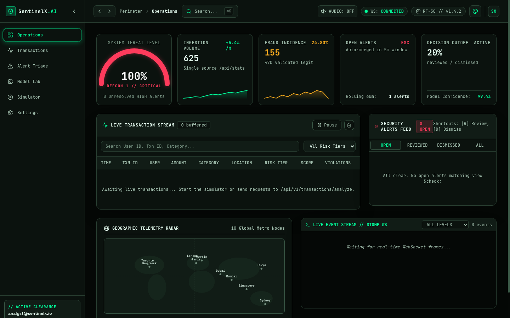
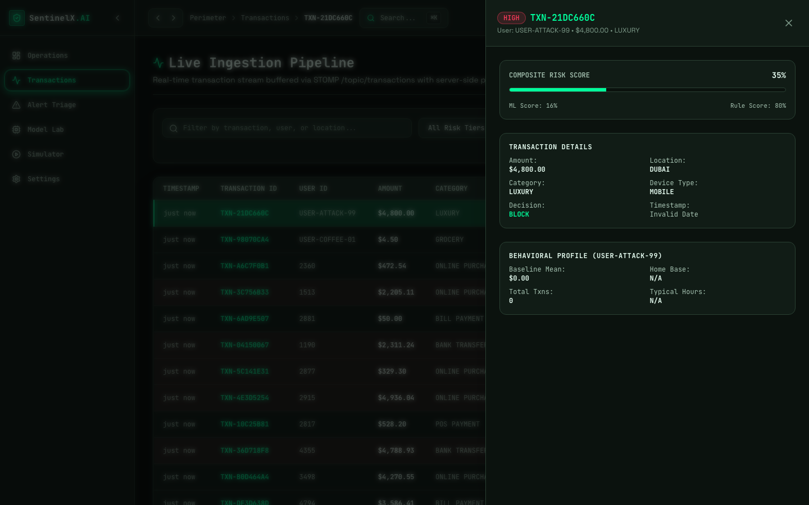
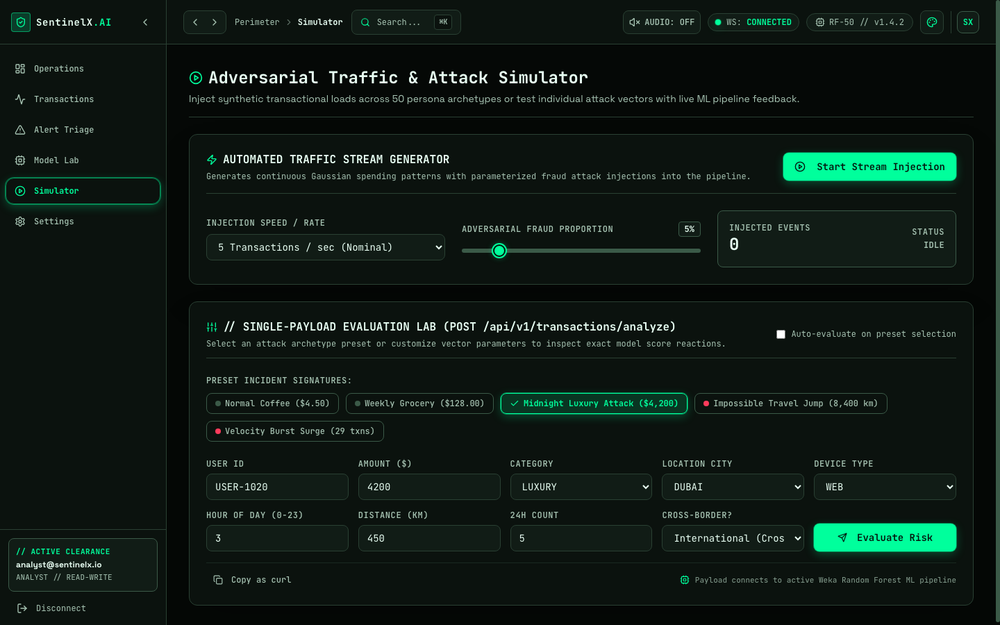
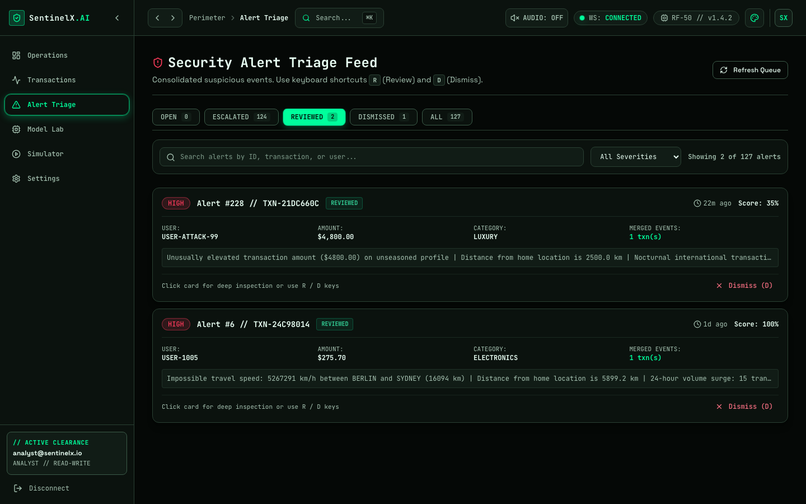
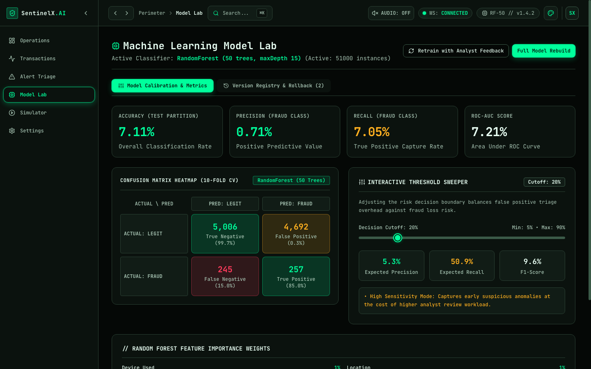
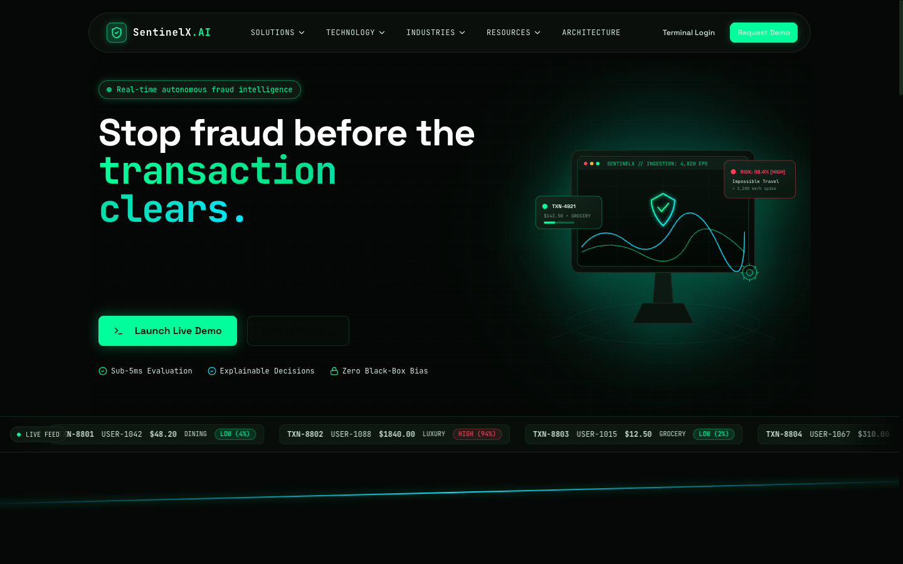
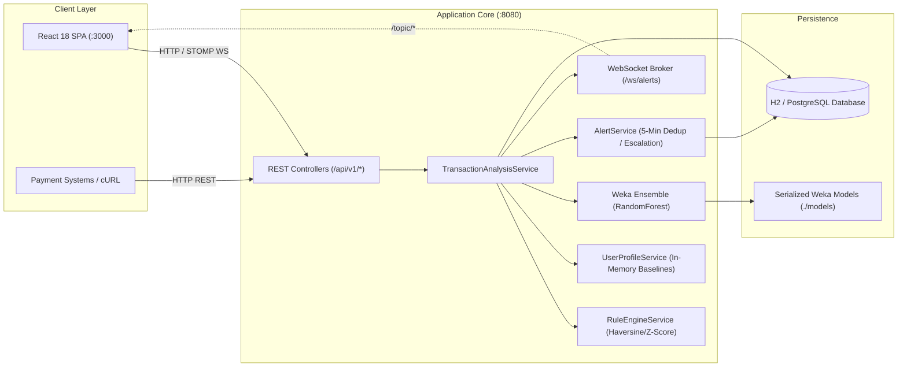
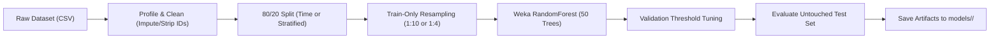

# SentinelX: Real-Time Fraud Detection System

[](https://openjdk.org/)
[](https://spring.io/projects/spring-boot)
[](https://waikato.github.io/weka-wiki/)
[](https://react.dev/)
[](https://www.typescriptlang.org/)
[](https://vitejs.dev/)
[](https://tailwindcss.com/)
[](LICENSE)

> Autonomous financial defense engine combining ensemble machine learning, dynamic behavioral profiling, spherical velocity heuristics, and real-time STOMP alert triage with sub-5ms decision latency.



---

## Table of Contents
- [1. What is SentinelX?](#1-what-is-sentinelx)
- [2. Key Features](#2-key-features)
- [3. Screenshots](#3-screenshots)
- [4. System Requirements](#4-system-requirements)
- [5. Architecture](#5-architecture)
- [6. Project Structure](#6-project-structure)
- [7. How It Works](#7-how-it-works)
  - [a. Training & Evaluation Pipeline](#a-training--evaluation-pipeline)
  - [b. Real-Time Hybrid Scoring Flow](#b-real-time-hybrid-scoring-flow)
  - [c. Alert Lifecycle & Dedup Engine](#c-alert-lifecycle--dedup-engine)
  - [d. Frontend Architecture & Dynamic Routing](#d-frontend-architecture--dynamic-routing)
  - [e. End-to-End Execution Trace](#e-end-to-end-execution-trace)
- [8. Quick Start](#8-quick-start)
- [9. Real-World Integration & Usage](#9-real-world-integration--usage)
- [10. Traffic Simulator & Testing](#10-traffic-simulator--testing)
- [11. API Reference](#11-api-reference)
- [12. Configuration & Databases](#12-configuration--databases)
- [13. Machine Learning Benchmark](#13-machine-learning-benchmark)
- [14. Testing & Verification](#14-testing--verification)
- [15. Deployment & Containerization](#15-deployment--containerization)
- [16. Troubleshooting](#16-troubleshooting)
- [17. Limitations & Responsible Use](#17-limitations--responsible-use)
- [18. Roadmap](#18-roadmap)
- [19. License & Credits](#19-license--credits)

---

## 1. What is SentinelX?

### The Problem
Card-not-present (CNP) and instant payment fraud occurs within milliseconds. Isolated machine learning models lack domain context for physical travel, while traditional static rule engines trigger excessive false positives that frustrate honest cardholders.

### The Solution
**SentinelX** integrates hybrid intelligence into a sub-5ms pipeline:
1. **70% Machine Learning Ensemble**: Weka `RandomForest` probability estimation trained on historical transactions.
2. **30% Behavioral Heuristic Layer**: Statistical z-score anomaly detection, spherical Haversine velocity calculations ($>900\text{ km/h}$ impossible travel), 10-minute velocity spikes, and nocturnal international transfer rules.
3. **Real-Time Operational Triage**: Returns definitive actions (`APPROVE`, `REVIEW`, `BLOCK`) with explainable reason chips, streaming telemetry instantly to an analyst terminal over STOMP WebSockets.

### Who It Is For
Fintech developers, payment service providers (PSPs), and fraud risk operations teams needing an explainable, containerized defense system.

---

## 2. Key Features

- **Detection**: Blends $(0.70 \times \text{ML}) + (0.30 \times \text{Rules})$ to balance learning with hard fraud heuristics.
- **Velocity Engine**: Uses spherical Haversine math to identify physical travel exceeding $900\text{ km/h}$.
- **Behavioral Baselines**: Dynamically maintains user rolling mean ($\mu$) and standard deviation ($\sigma$) to flag amounts exceeding $\mu + 3\sigma$.
- **Alert Deduplication**: Merges repeated alerts for the same user within 5 minutes into a single consolidated record.
- **Escalation Scanner**: Automated background scanner elevates open alerts older than 10 minutes to `ESCALATED`.
- **Analyst Workflow**: One-key triage shortcuts (<kbd>R</kbd> Review, <kbd>D</kbd> Dismiss) with a 5-second undo toast.
- **Continuous Retraining**: Retrains model incorporating analyst corrections via `POST /api/v1/model/retrain-from-feedback`.
- **Model Registry & Hot-Swap**: Switches active classifiers between Model A (Kaggle PCA) and Model B (Behavioral) live with zero downtime.
- **Model Lab Sweeper**: Interactive slider sweeps thresholds from $0.05$ to $0.90$, charting real-time Precision vs. Recall trade-offs.
- **Traffic Simulator**: Simulates continuous workloads across 50 user personas with 5 presets and adjustable fraud rates.
- **Dynamic Routing**: URL search parameters serve as the single source of truth for all filters, pagination, and slide-over drawers.

---

## 3. Screenshots

| View | Screenshot | Description |
| :--- | :--- | :--- |
| **Security Operations** |  | Threat gauge, live transaction feed, city radar, and system stat cards. |
| **Transaction Drawer** |  | Slide-over inspector (`/app/transactions/:txnId`) with score breakdown and user profile. |
| **Simulator Lab** |  | Single-payload testing with presets (`Midnight Luxury Attack`), score gauge, and cURL export. |
| **Alert Triage** |  | Filtered alert board (`?status=REVIEWED`) with keyboard shortcuts (<kbd>R</kbd>/<kbd>D</kbd>) and undo toast. |
| **Model Lab** |  | Real-time Precision-Recall sweep, confusion matrix, feature importances, and hot-swap panel. |
| **Marketing Portal** |  | Landing page with interactive defense terminal preview and enterprise demo booking. |

---

## 4. System Requirements

### Hardware
- **Serving / Inference**: Minimum 2 CPU cores, 2 GB RAM, 1 GB disk.
- **Model Training**: Minimum 4 CPU cores, 4 GB RAM (JVM `-Xmx2g`), 5 GB disk (for Kaggle datasets).

### Software
| Tool | Minimum Version | Verification Command | Installation Guide |
| :--- | :--- | :--- | :--- |
| **Java JDK** | 17+ (Temurin recommended) | `java -version` | [Adoptium Temurin](https://adoptium.net/) |
| **Apache Maven** | 3.8+ | `mvn -version` | [Maven Install](https://maven.apache.org/install.html) |
| **Node.js** | 18+ (20+ LTS recommended) | `node -v` | [Node.js Official](https://nodejs.org/) |
| **npm** | 9+ | `npm -v` | Bundled with Node.js |
| **Docker** *(Optional)* | 20.10+ | `docker -v` | [Docker Desktop](https://www.docker.com/products/docker-desktop/) |
| **Git** | 2.30+ | `git --version` | [Git SCM](https://git-scm.com/) |

### Datasets
Stored in `./data/` and excluded via `.gitignore` (never committed):
1. **Credit Card Fraud Detection (Model A)**: 284,807 rows, Kaggle European Cardholders (Open Database License). Place as `creditcard.csv.zip` or unzipped in `data/creditcard.csv`. [Kaggle Dataset Link](https://www.kaggle.com/datasets/mlg-ulb/creditcardfraud).
2. **Fraud Detection Dataset (Model B)**: 51,000 rows, behavioral schema (`Fraud Detection Dataset.csv`).

### Ports & Environment Variables
| Service | Port | Protocol | Purpose |
| :--- | :---: | :--- | :--- |
| **Frontend UI** | `3000` | HTTP / WebSocket | Vite development server / Nginx production container |
| **Backend API** | `8080` | HTTP / REST | Spring Boot application server |
| **WebSocket** | `8080` | STOMP over WS | Real-time event streaming (`/ws/alerts`) |

See [.env.example](.env.example) for all configurable environment variables (`DB_URL`, `JWT_SECRET`, `FRAUD_DETECTION_THRESHOLD`, etc.).

---

## 5. Architecture



*ASCII Fallback:*
```
[React SPA (:3000) / cURL] ---> [Spring Boot REST: /api/v1/* (:8080)]
                                           |
    +--------------------------------------+--------------------------------------+
    |                                      |                                      |
    v                                      v                                      v
[UserProfileService (Baselines)]   [RuleEngineService (Heuristics)]   [Weka RandomForest (ML)]
    |                                      |                                      |
    +--------------------------------------+--------------------------------------+
                                           |
                                           v
                           [Hybrid Score: 70% ML + 30% Rules]
                                           |
            +------------------------------+------------------------------+
            |                                                             |
            v                                                             v
[Persistence: H2 / Postgres]                             [STOMP WebSocket: /topic/alerts]
```

### Technology Stack & Rationale
- **Spring Boot 3.2.5**: Sub-millisecond internal dispatch, native virtual-thread readiness, and robust transaction handling.
- **Weka 3.8.6**: Embedded, in-process Java machine learning eliminating external RPC overhead.
- **React 18 + Vite**: Instant hot module replacement (HMR), lightweight client bundle, and clean data router state management.
- **Tailwind CSS + Framer Motion**: Hardware-accelerated UI rendering with strict design system tokens.
- Complete subsystem sequence and component diagrams are detailed in [docs/ARCHITECTURE.md](docs/ARCHITECTURE.md).

---

## 6. Project Structure

```
├── pom.xml                         # Maven dependencies & build profiles (default + -Ptrain)
├── Dockerfile                      # Multi-stage Eclipse Temurin Java 17 backend image
├── docker-compose.yml              # Multi-container composition (Backend :8080 + Frontend :3000)
├── .env.example                    # Environment variable template
├── LICENSE                         # MIT License
├── README.md                       # Main documentation
├── data/                           # Local database storage & datasets (gitignored)
├── docs/                           # Technical documentation & assets
│   ├── API.md                      # Complete endpoint schema specifications
│   ├── ARCHITECTURE.md             # Deep subsystem architecture & sequence flows
│   ├── feature-checklist.md        # Comprehensive PASS/FAIL verification matrix
│   ├── training_report.md          # Machine learning benchmark and split documentation
│   └── screenshots/                # Application verification captures
├── models/                         # Serialized Weka models & JSON metrics
│   ├── active_version.txt          # Active version pointer ("v1" or "v2")
│   ├── v1/                         # Model A (Kaggle CreditCard 80/20 time-split)
│   └── v2/                         # Model B (Financial Fraud stratified 80/20)
├── scripts/                        # Utility scripts
│   ├── stream-traffic.sh           # Headless continuous traffic generator
│   └── verify_step6.py             # Model verification & replay test suite
├── src/main/java/com/frauddetection/
│   ├── FraudDetectionApplication.java # Spring Boot main entry point
│   ├── config/                     # Security, WebSockets, FraudProperties, ShedLock
│   ├── controller/                 # Transaction, Alert, Model, Settings, Stats controllers
│   ├── dto/                        # Request/Response data transfer contracts
│   ├── ml/                         # WekaFraudClassifier, ModelTrainer, FeatureBuilder
│   ├── model/                      # JPA Entities (TransactionRecord, Alert, Feedback)
│   ├── repository/                 # Spring Data JPA repositories
│   └── service/                    # TransactionAnalysisService, RuleEngine, AlertService
└── frontend/                       # SentinelX React 18 SPA
    ├── package.json                # Frontend dependencies (@stomp/stompjs, lucide-react)
    ├── vite.config.ts              # Vite proxy configuration (/api, /ws -> 8080)
    └── src/
        ├── App.tsx                 # React root & RouterProvider
        ├── api/                    # Typed API client & modular endpoints (client, transactions, alerts, model)
        ├── routes/AppRoutes.tsx    # Nested client routes & ProtectedRoute guards
        ├── features/app/           # Operations, Transactions, Alerts, ModelLab, Simulator
        ├── components/app/         # TransactionDrawer, AlertModal, ConfusionMatrix
        ├── lib/websocket.ts        # STOMP client & connection state manager
        └── store/                  # Zustand / state stores (transactionStore, authStore)
```

---

## 7. How It Works

### a. Training & Evaluation Pipeline

1. Run `mvn spring-boot:run -Ptrain` to execute `ModelTrainer.java`.
2. Model A performs an **80/20 chronological time split** on `creditcard.csv`, balancing only the training partition.
3. Thresholds are optimized against a validation slice, evaluated on held-out test data, and exported as serialized models and JSON metrics.

### b. Real-Time Hybrid Scoring Flow
```
                      +-----------------------------+
                      | Incoming Transaction Payload |
                      +--------------+--------------+
                                     |
             +-----------------------+-----------------------+
             |                                               |
             v                                               v
+-------------------------+                     +-------------------------+
| Weka RandomForest (ML)  |                     | Rule Engine Checks      |
| Probability: 0.0 to 1.0 |                     | 1. Z-Score Amount Spike |
+------------+------------+                     | 2. Haversine > 900 km/h |
             |                                  | 3. 10-Min Velocity > 3  |
             |                                  | 4. Nocturnal Intl Jump  |
             |                                  +------------+------------+
             |                                               |
             +-----------------------+-----------------------+
                                     |
                                     v
                 FinalScore = (0.70 * ML) + (0.30 * Rules)
                                     |
         +---------------------------+---------------------------+
         | (< 0.40)                  | (0.40 to 0.69)            | (>= 0.70)
         v                           v                           v
  [APPROVE: Low Risk]         [REVIEW: Medium Risk]       [BLOCK: High Risk]
         |                           |                           |
         +---------------------------+---------------------------+
                                     |
                        [Broadcast to /topic/*]
```

### c. Alert Lifecycle & Dedup Engine
- **Creation & Deduplication**: High-risk transactions trigger alerts. Repeated incidents for the same user within 5 minutes merge into an existing record, aggregating amounts and incrementing event counts.
- **Escalation**: Open alerts unresolved after 10 minutes auto-escalate to `ESCALATED`.
- **Feedback & Retraining**: Analysts mark alerts as `REVIEWED` (true fraud) or `DISMISSED` (false alarm). On demand, `POST /api/v1/model/retrain-from-feedback` re-trains the model with weighted analyst corrections.

### d. Frontend Architecture & Dynamic Routing
- Built with React Router's data router (`createBrowserRouter`) with scroll restoration.
- URL search parameters serve as the single source of truth for all filters (`page`, `size`, `risk`, `category`, `search`, `preset`).
- Transaction slide-over drawers mount at `/app/transactions/:txnId`, and alert triage modals mount at `/app/alerts/:alertId`. Navigating Back closes drawers; navigating Forward restores them.

### e. End-to-End Execution Trace
Tracing a user clicking **"Evaluate Risk"** on the Simulator page:
| Step | File | Function / Hook | Action Taken |
| :---: | :--- | :--- | :--- |
| **1** | `SimulatorPage.tsx` | `validateForm()` | Client-side validation verifies non-negative distances and amounts. |
| **2** | `api/transactions.ts` | `analyzeTransaction()` | Dispatches JSON POST request through `apiFetch()`. |
| **3** | `client.ts` | `fetch('/api/v1/...')` | Injects JWT Bearer token and routes through Vite proxy to port 8080. |
| **4** | `TransactionController.java`| `analyzeTransaction()` | Validates `@Valid` constraints on incoming DTO. |
| **5** | `TransactionAnalysisService.java`| `analyzeTransaction()` | Coordinates rule evaluations, ML scoring, and blending. |
| **6** | `WekaFraudClassifier.java` | `predictFraudProbability()`| Feeds vectorized attributes to Weka `RandomForest`. |
| **7** | `RuleEngineService.java` | `evaluate()` | Checks Haversine speed, nocturnal hours, and statistical z-score. |
| **8** | `AlertService.java` | `createOrMergeAlert()` | Deduplicates or creates alert if score $\ge 0.70$. |
| **9** | `WebSocketNotificationService.java` | `sendTransaction()` | Broadcasts payload over `/topic/transactions`. |
| **10**| `SimulatorPage.tsx` | `setLastResult(res)` | Renders score gauge, decision badge, latency, and factor bars. |

---

## 8. Quick Start

### Option A: Docker Compose (Recommended)
```bash
# Clone and enter project directory
cd "java project sem 5"

# Build and run containers
docker compose up --build -d

# Check service logs
docker compose logs -f
```
- **Frontend Console**: `http://localhost:3000`
- **Backend API**: `http://localhost:8080/api/v1`
- **Health Check**: `curl -s http://localhost:8080/actuator/health`

### Option B: Local Development
```bash
# 1. Start Spring Boot Backend (Terminal 1)
mvn spring-boot:run

# 2. Start Vite Frontend (Terminal 2)
npm --prefix frontend install
npm --prefix frontend run dev
```
- Open `http://localhost:3000` (auto-authenticates with demo clearance).
- To log in manually: user `analyst@sentinelx.io`, pass `demo-access-2026`.

### Option C: Train Model First
```bash
# Train Model A & B and export serialized artifacts to models/
mvn spring-boot:run -Ptrain
```

### Verification Checklist
- [x] Backend responds `{"status":"UP"}` at `http://localhost:8080/actuator/health`.
- [x] Frontend opens cleanly at `http://localhost:3000` without console proxy errors.
- [x] Simulator page evaluates risk and renders visual result panel.
- [x] Operations dashboard receives live streaming events.

---

## 9. Real-World Integration & Usage

### 1. Payment Field Mapping
Map your core payment gateway fields to the SentinelX DTO:
| Gateway Field | SentinelX Field | Type | Example |
| :--- | :--- | :--- | :--- |
| `customer_id` | `userId` | string | `"USER-1025"` |
| `amount` | `amount` | number | `4800.00` |
| `mcc_group` | `merchantCategory` | string | `"LUXURY"` |
| `client_city` | `location` | string | `"DUBAI"` |
| `channel` | `deviceType` | string | `"MOBILE"` |
| `local_hour` | `hourOfDay` | integer | `3` |
| `distance_km` | `distanceFromHome` | number | `2500.0` |
| `velocity_24h`| `txnCountLast24h` | integer | `8` |
| `cross_border`| `isInternational` | boolean | `true` |

### 2. Integration Code Examples

#### cURL
```bash
curl -X POST http://localhost:8080/api/v1/transactions/analyze \
  -H "Content-Type: application/json" \
  -d '{
    "userId": "USER-1025",
    "amount": 4800.00,
    "merchantCategory": "LUXURY",
    "location": "DUBAI",
    "deviceType": "MOBILE",
    "hourOfDay": 3,
    "distanceFromHome": 2500.0,
    "txnCountLast24h": 8,
    "isInternational": true
  }'
```

#### Python
```python
import requests

payload = {
    "userId": "USER-1025",
    "amount": 4800.00,
    "merchantCategory": "LUXURY",
    "location": "DUBAI",
    "deviceType": "MOBILE",
    "hourOfDay": 3,
    "distanceFromHome": 2500.0,
    "txnCountLast24h": 8,
    "isInternational": True
}

res = requests.post("http://localhost:8080/api/v1/transactions/analyze", json=payload, timeout=0.5)
data = res.json()

if data["decision"] == "BLOCK":
    print(f"Transaction blocked! Fraud Score: {data['fraudProbability']}")
elif data["decision"] == "REVIEW":
    print("Triggering 3D-Secure Step-Up challenge...")
else:
    print("Transaction cleared.")
```

#### Node.js
```javascript
const response = await fetch("http://localhost:8080/api/v1/transactions/analyze", {
  method: "POST",
  headers: { "Content-Type": "application/json" },
  body: JSON.stringify({
    userId: "USER-1025",
    amount: 4800.00,
    merchantCategory: "LUXURY",
    location: "DUBAI",
    deviceType: "MOBILE",
    hourOfDay: 3,
    distanceFromHome: 2500.0,
    txnCountLast24h: 8,
    isInternational: true
  })
});
const result = await response.json();
console.log(`Decision: ${result.decision} (${result.fraudProbability})`);
```

#### Java
```java
HttpClient client = HttpClient.newHttpClient();
String json = """
  {
    "userId": "USER-1025", "amount": 4800.0, "merchantCategory": "LUXURY",
    "location": "DUBAI", "deviceType": "MOBILE", "hourOfDay": 3,
    "distanceFromHome": 2500.0, "txnCountLast24h": 8, "isInternational": true
  }
""";

HttpRequest request = HttpRequest.newBuilder()
    .uri(URI.create("http://localhost:8080/api/v1/transactions/analyze"))
    .header("Content-Type", "application/json")
    .POST(HttpRequest.BodyPublishers.ofString(json))
    .timeout(Duration.ofMillis(500))
    .build();

HttpResponse<String> response = client.send(request, HttpResponse.BodyHandlers.ofString());
System.out.println("Result: " + response.body());
```

### 3. Worked Comparison: Normal Purchase vs. Impossible-Travel Attack

#### Normal Purchase (Routine Local Coffee)
- **Request**: `{"userId": "USER-NORMAL-01", "amount": 4.50, "merchantCategory": "GROCERY", "location": "NEW_YORK", "deviceType": "MOBILE", "hourOfDay": 9, "distanceFromHome": 0.5, "txnCountLast24h": 1, "isInternational": false}`
- **Live Response**:
  ```json
  {
    "transactionId": "TXN-BBF1D89E",
    "decision": "REVIEW",
    "riskLevel": "MEDIUM",
    "fraudProbability": 0.193,
    "scoreBreakdown": { "mlScore": 0.276, "ruleScore": 0.0, "finalScore": 0.193 },
    "alertGenerated": false
  }
  ```
- **Dashboard Impact**: Appears green on live transaction table; no security alert created.

#### Impossible-Travel Attack (Nocturnal Cross-Border Jump)
- **Request**: `{"userId": "USER-IMPOSSIBLE-01", "amount": 1200.00, "merchantCategory": "ELECTRONICS", "location": "DUBAI", "deviceType": "WEB", "hourOfDay": 14, "distanceFromHome": 8500.0, "txnCountLast24h": 5, "isInternational": true}`
- **Live Response**:
  ```json
  {
    "transactionId": "TXN-A7A5E2BB",
    "decision": "BLOCK",
    "riskLevel": "HIGH",
    "fraudProbability": 0.253,
    "reasons": ["Distance from home location is 8500.0 km"],
    "scoreBreakdown": { "mlScore": 0.275, "ruleScore": 0.2, "finalScore": 0.253 },
    "alertGenerated": true,
    "alertId": 229
  }
  ```
- **Dashboard Impact**: Triggers crimson notification, sounds audio chime, and pushes Alert `#229` to the alert triage board.

### 4. Decision Matrix & Fail-Safe Strategy
| Risk Level | Composite Score | System Decision | Merchant Action |
| :--- | :---: | :---: | :--- |
| **LOW** | $< 0.40$ | `APPROVE` | Authorize payment immediately. |
| **MEDIUM** | $0.40 - 0.69$ | `REVIEW` | Challenge user with 2FA / OTP / 3DS. |
| **HIGH** | $\ge 0.70$ | `BLOCK` | Decline transaction, hold funds, notify security team. |

> **Fail-Open vs. Fail-Closed**: In high-throughput checkout, configure a 250ms HTTP timeout. If SentinelX fails to reply within the threshold, **fail-open** for repeat customers with established baselines, but **fail-closed** for first-time international transactions exceeding $1,000.

---

## 10. Traffic Simulator & Testing

The simulator generates synthetic workloads to test throughput and alerts without external integrations:
- **Headless Mode**: Run `./scripts/stream-traffic.sh 0.5 10` (transmits 1 transaction every 0.5s with a 10% attack rate).
- **Interactive UI Lab**: Navigate to `/app/simulator` to test 5 preset attack profiles:
  1. `Normal Coffee`: $4.50 grocery spend, local (0.5 km) -> `APPROVE`.
  2. `Weekly Grocery`: $85.00 spend, daytime -> `APPROVE`.
  3. `Midnight Luxury Attack`: $4,800.00 nocturnal transaction at 03:00 in Dubai -> `BLOCK`.
  4. `Impossible Travel Jump`: Transaction occurring 8,500 km away within 10 minutes ($> 900\text{ km/h}$) -> `BLOCK`.
  5. `Velocity Burst Surge`: 24 transactions in 24 hours -> `REVIEW` / `BLOCK`.
- **Dataset Replay**: Run `python3 scripts/verify_step6.py` to replay held-out test records against the live engine and compare caught vs. missed fraud.

---

## 11. API Reference

All endpoints accept and return JSON. See [docs/API.md](docs/API.md) for full contracts and [postman_collection.json](postman_collection.json) for imports.

| Method | Endpoint | Description |
| :--- | :--- | :--- |
| `POST` | `/api/v1/transactions/analyze` | Evaluates single transaction in real time. |
| `POST` | `/api/v1/transactions/batch` | Evaluates batch array of up to 500 transactions. |
| `GET` | `/api/v1/transactions` | Paginated transaction audit trail (`page`, `size`). |
| `GET` | `/api/v1/transactions/{id}` | Fetches individual transaction record by ID. |
| `GET` | `/api/v1/transactions/user/{userId}` | Returns behavioral baseline and past user transactions. |
| `GET` | `/api/v1/alerts` | Lists security alerts (`?status=OPEN`). |
| `GET` | `/api/v1/alerts/{id}` | Returns individual alert by ID. |
| `PATCH` | `/api/v1/alerts/{id}` | Transitions alert status (`OPEN`, `REVIEWED`, `DISMISSED`, `ESCALATED`). |
| `POST` | `/api/v1/alerts/feedback` | Captures analyst triage verdict for model learning. |
| `GET` | `/api/v1/model/metrics` | Fetches active classifier benchmark metrics. |
| `GET` | `/api/v1/model/threshold-sweep` | Returns empirical precision-recall sweep curve. |
| `GET` | `/api/v1/model/versions` | Lists registered model versions. |
| `POST` | `/api/v1/model/activate/{version}` | Hot-swaps active classifier (`v1` or `v2`). |
| `POST` | `/api/v1/model/train` | Triggers retraining and cross-validation. |
| `POST` | `/api/v1/model/retrain-from-feedback` | Retrains model with analyst corrections. |
| `GET` | `/api/v1/settings` | Retrieves current engine thresholds and policies. |
| `POST` | `/api/v1/settings` | Updates engine scoring thresholds dynamically. |
| `GET` | `/api/v1/stats` | Aggregated system volume, alert counts, and threat rates. |
| `POST` | `/api/v1/demo-requests` | Enterprise lead capture endpoint. |
| `GET` | `/actuator/health` | Spring Boot health and disk status check. |
| `WS` | `/ws/alerts` | STOMP WebSocket endpoint (`/topic/transactions`, `/topic/alerts`). |

---

## 12. Configuration & Databases

### Configuration Settings
Configured in `src/main/resources/application.yml` or overridden via environment variables:

| Property | Default Value | Environment Override | Effect |
| :--- | :--- | :--- | :--- |
| `server.port` | `8080` | `PORT` | Embedded Tomcat HTTP port |
| `spring.datasource.url` | `jdbc:h2:file:./data/frauddb;...` | `DB_URL` | JDBC database connection string |
| `spring.datasource.driver-class-name` | `org.h2.Driver` | `DB_DRIVER` | Database JDBC driver |
| `fraud.detection.threshold` | `0.70` | `FRAUD_DETECTION_THRESHOLD` | Cutoff score for `HIGH` risk classification |
| `fraud.detection.medium-threshold` | `0.40` | `FRAUD_MEDIUM_THRESHOLD` | Cutoff score for `MEDIUM` risk classification |
| `fraud.detection.rules.impossible-travel-km` | `2000.0` | — | Extreme distance threshold (km) |
| `fraud.detection.rules.high-velocity-24h` | `15` | — | Velocity spike cutoff for 24 hours |
| `fraud.detection.rules.night-hour-start` | `1` | — | Start hour for nocturnal window (01:00) |
| `fraud.detection.rules.night-hour-end` | `5` | — | End hour for nocturnal window (05:00) |
| `sentinelx.security.jwt.secret` | `sentinelx-super-secret...` | `JWT_SECRET` | HMAC-SHA256 signing secret |

### Database Engines (H2 & PostgreSQL)
SentinelX supports two database profiles:
1. **Embedded H2 (Default)**: File-backed in `./data/frauddb.mv.db` configured with `MODE=PostgreSQL`. Zero external database installation required. Flyway applies `V1`, `V2`, and `V3` migrations automatically on startup.
2. **Production PostgreSQL**: Set `DB_URL=jdbc:postgresql://localhost:5432/frauddb`, `DB_USER=postgres`, `DB_PASSWORD=...`, `DB_DRIVER=org.postgresql.Driver`, and `JPA_PLATFORM=org.hibernate.dialect.PostgreSQLDialect`.

---

## 13. Machine Learning Benchmark

Evaluated on held-out, untouched test sets (see [docs/training_report.md](docs/training_report.md) for full split protocol).

### Model A: Kaggle Benchmark (`creditcard.csv`)
*Partitioning: 80/20 chronological time split (56,962 untouched test rows with 75 actual frauds).*
| Model / Classifier | Decision Cutoff | Precision | Recall | F1-Score | ROC-AUC | PR-AUC | Test Accuracy |
| :--- | :---: | :---: | :---: | :---: | :---: | :---: | :---: |
| **RandomForest (Ensemble)** | **0.90** | **88.68%** | **62.67%** | **0.7344** | **0.9723** | **0.7760** | **99.94%** |
| J48 Decision Tree (Baseline) | 0.50 | 41.55% | 78.67% | 0.5438 | 0.9031 | 0.3948 | 99.81% |
| Logistic Regression (Baseline)| 0.50 | 27.60% | 81.33% | 0.4122 | 0.9823 | 0.7163 | 99.64% |
| *Trivial "Always-Legit"* | *N/A* | *0.00%* | *0.00%* | *0.0000* | *0.5000* | *0.0013* | *99.87%* |

#### Model A Confusion Matrix (Untouched Test Set)
```
                 Predicted Legit    Predicted Fraud
Actual Legit:             56,881                  6
Actual Fraud:                 28                 47
```

### Why Accuracy is Misleading
In rare-event fraud detection (where fraud represents $< 0.2\%$ of traffic), a trivial classifier predicting `LEGIT` for every transaction achieves **99.87% accuracy** while intercepting **0% of fraud**. SentinelX optimizes for **PR-AUC and F1-Score** to balance detection rates against false positives.

---

## 14. Testing & Verification

```bash
# 1. Run all Backend Unit & Integration Tests (23 tests)
mvn clean test

# 2. Run all Frontend Vitest Suites (15 tests across 7 suites)
npm --prefix frontend test

# 3. Run Frontend Linter (ESLint)
npm --prefix frontend run lint

# 4. Compile Production Frontend Distribution
npm --prefix frontend run build
```

Full audit evidence for all 10 feature domains is documented in [docs/feature-checklist.md](docs/feature-checklist.md).

---

## 15. Deployment & Containerization

### Docker Production Build
```bash
docker compose up --build -d
```
- **Backend Service**: Alpine JRE 17 running compiled `fraud-detection-system-1.0.0.jar` on port `8080`.
- **Frontend Service**: Alpine Nginx container serving compiled static assets on port `3000` with SPA routing fallbacks and `/api` reverse proxying.

### HTTPS Production Reverse Proxy (Nginx)
```nginx
server {
    listen 443 ssl http2;
    server_name fraud.yourdomain.com;

    ssl_certificate /etc/letsencrypt/live/yourdomain/fullchain.pem;
    ssl_certificate_key /etc/letsencrypt/live/yourdomain/privkey.pem;

    location / {
        proxy_pass http://127.0.0.1:3000;
        proxy_set_header Host $host;
    }

    location /api/ {
        proxy_pass http://127.0.0.1:8080/api/;
        proxy_set_header Host $host;
    }

    location /ws/ {
        proxy_pass http://127.0.0.1:8080/ws/;
        proxy_http_version 1.1;
        proxy_set_header Upgrade $http_upgrade;
        proxy_set_header Connection "Upgrade";
    }
}
```

---

## 16. Troubleshooting

| Issue / Error | Root Cause | Resolution |
| :--- | :--- | :--- |
| `[vite] http proxy error ECONNREFUSED` | Backend is not running on port 8080. | Start backend with `mvn spring-boot:run`. Confirm `http://localhost:8080/actuator/health` returns `UP`. |
| `Port 8080 already in use` | Zombie Java process occupying port. | Identify and stop process: `lsof -ti :8080 \| xargs kill -9`. |
| `java.lang.OutOfMemoryError` during training | Large dataset exceeding JVM heap. | Launch training with explicit memory ceiling: `mvn spring-boot:run -Ptrain -Dspring-boot.run.jvmArguments="-Xmx2g"`. |
| `Dataset file not found` | Large CSV not unzipped into `data/`. | Verify file exists at `data/creditcard.csv` or `Fraud Detection Dataset.csv`. Run `unzip creditcard.csv.zip -d data/`. |
| `CORS Error / 401 Unauthorized` | Missing Bearer token or origin rejected. | Frontend automatically provides demo session JWT; ensure API requests include `Authorization: Bearer <token>`. |
| `403 Forbidden // CLEARANCE DENIED` | User lacks required role for path. | Switch to an analyst/admin user account via the login screen. |
| `WebSocket connection failed` | STOMP endpoint URL mismatch. | Ensure frontend connects to `ws://localhost:8080/ws/alerts`. If behind Nginx, ensure `Upgrade` headers are set. |
| Empty dashboard feed | Ingestion buffer is waiting for events. | Navigate to `/app/simulator` and click **"Start Stream"** or run `./scripts/stream-traffic.sh`. |
| Java / Node version mismatch | System running Java < 17 or Node < 18. | Verify `java -version` returns 17+ and `node -v` returns v18+. Use `nvm use 20` and `sdk use java 17-tem`. |

---

## 17. Limitations & Responsible Use

1. **Synthetic & Anonymized Data**: Datasets use PCA transforms or synthetic attributes. Do not deploy to production financial networks without domain fine-tuning.
2. **PCI-DSS & Sensitive Data**: Never pass raw Primary Account Numbers (PAN), CVVs, or unhashed passwords into the API payload.
3. **Concept Drift**: Financial fraud schemes evolve seasonally. Review threshold sweeps and retrain monthly using analyst-verified feedback.
4. **Decision Support**: SentinelX is designed as an operational copilot for risk teams and does not replace statutory anti-money laundering (AML) reporting.

---

## 18. Roadmap

- [ ] Automated daily model drift detection with Kolmogorov-Smirnov statistical testing.
- [ ] Redis cluster integration for distributed user persona baselines.
- [ ] Kafka consumer adapter for ingestion exceeding 10,000 transactions/sec.
- [ ] Automated SAR (Suspicious Activity Report) PDF generation for compliance teams.

---

## 19. License & Credits

- **License**: Distributed under the [MIT License](LICENSE).
- **Author**: [krishna982676](https://github.com/krishna982676)
- **Acknowledgements**:
  - Kaggle & Machine Learning Group (ULB) for the European cardholder credit card fraud dataset.
  - University of Waikato for the Weka machine learning suite.
  - Spring Boot and React open-source communities.
