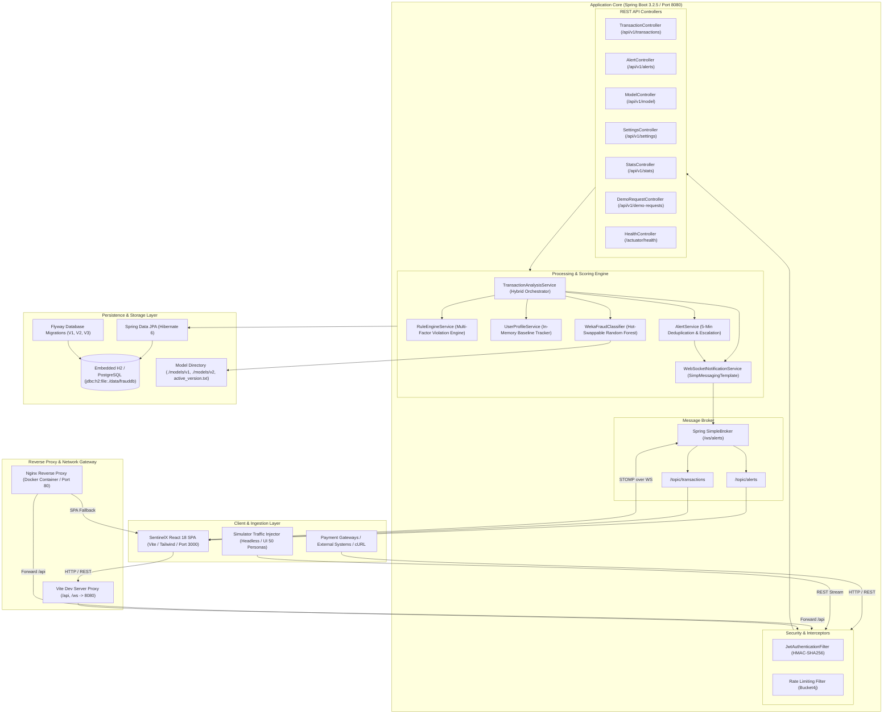
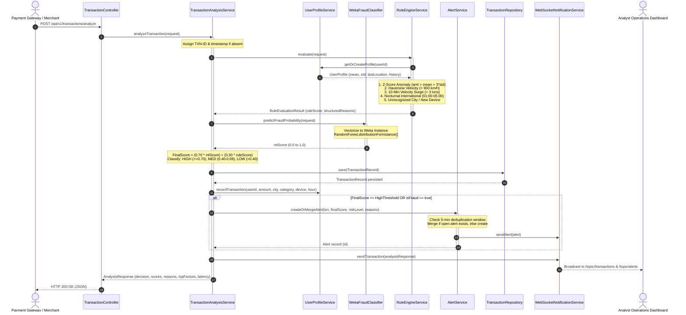
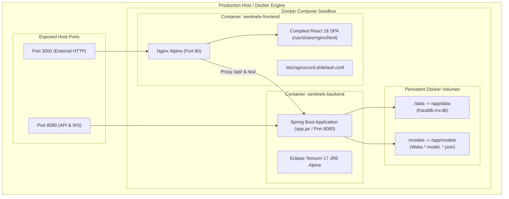
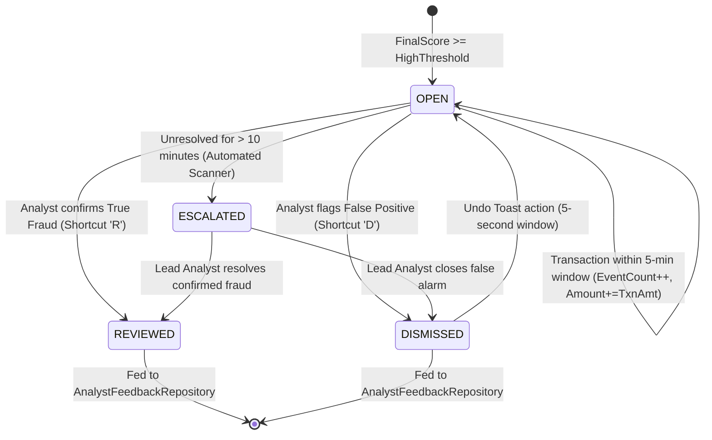

# SentinelX System Architecture & Technical Specifications

This document provides an in-depth architectural breakdown of the **SentinelX Real-Time Autonomous Fraud Detection System**, detailing the subsystem components, communication protocols, sequence flows, database entity relationships, and containerized deployment infrastructure.

---

## 1. System Component Architecture



---

## 2. End-to-End Real-Time Transaction Scoring Sequence

The sequence diagram below traces an incoming financial transaction through validation, user profiling, machine learning inference, statistical rule evaluations, score blending, alert management, and real-time dashboard notification.



---

## 3. Database Entity Relationship (ER) Diagram

The system employs file-backed embedded H2 in PostgreSQL compatibility mode for local development, and standard PostgreSQL for enterprise deployments. Schemas are governed by Flyway (`V1__baseline_schema.sql`, `V2__multi_tenancy_and_auth.sql`, `V3__shedlock_and_webhooks.sql`).

```mermaid
erDiagram
    ORGANIZATIONS ||--o{ USERS : "has members"
    ORGANIZATIONS ||--o{ TRANSACTIONS : "owns"
    ORGANIZATIONS ||--o{ ALERTS : "owns"
    ORGANIZATIONS ||--o{ ANALYST_FEEDBACK : "owns"
    ORGANIZATIONS ||--o{ API_KEYS : "issues"
    ORGANIZATIONS ||--o| SUBSCRIPTIONS : "has"
    ORGANIZATIONS ||--o{ USAGE_COUNTERS : "tracks"
    USERS ||--o{ API_KEYS : "generates"
    ALERTS ||--o{ ANALYST_FEEDBACK : "triaged in"
    TRANSACTIONS ||--o| ALERTS : "triggers"

    ORGANIZATIONS {
        varchar(36) id PK
        varchar(255) name
        varchar(255) slug UK
        varchar(32) status
        varchar(32) plan
        double precision risk_threshold
        double precision medium_risk_threshold
        timestamp created_at
    }

    USERS {
        varchar(36) id PK
        varchar(36) organization_id FK
        varchar(255) email UK
        varchar(255) password_hash
        varchar(32) role
        int failed_login_attempts
        timestamp locked_until
        timestamp created_at
    }

    API_KEYS {
        varchar(36) id PK
        varchar(36) organization_id FK
        varchar(36) user_id FK
        varchar(16) key_prefix
        varchar(128) key_hash UK
        boolean is_revoked
        timestamp last_used_at
        timestamp created_at
    }

    TRANSACTIONS {
        bigint id PK
        varchar(36) organization_id FK
        varchar(64) transaction_id UK
        varchar(64) user_id
        double precision amount
        varchar(32) merchant_category
        varchar(64) location
        varchar(32) device_type
        int hour_of_day
        double precision distance_from_home
        int txn_count_last_24h
        boolean is_international
        double precision fraud_probability
        double precision ml_score
        double precision rule_score
        double precision final_score
        boolean is_fraud
        varchar(16) risk_level
        varchar(2000) reasons
        varchar(4000) structured_reasons_json
        timestamp created_at
    }

    ALERTS {
        bigint id PK
        varchar(36) organization_id FK
        varchar(64) transaction_id
        varchar(64) user_id
        double precision amount
        varchar(32) merchant_category
        varchar(64) location
        double precision fraud_probability
        varchar(16) risk_level
        varchar(2000) reasons
        varchar(4000) structured_reasons_json
        int event_count
        varchar(16) status
        timestamp created_at
        timestamp last_event_at
        timestamp updated_at
    }

    ANALYST_FEEDBACK {
        bigint id PK
        varchar(36) organization_id FK
        bigint alert_id FK
        varchar(64) transaction_id
        varchar(64) user_id
        double precision amount
        boolean is_actual_fraud
        varchar(1000) notes
        timestamp created_at
    }

    USER_PROFILES {
        bigint id PK
        varchar(36) organization_id FK
        varchar(64) user_id UK
        double precision sum_amount
        double precision sum_sq_amount
        bigint txn_count
        varchar(64) primary_city
        varchar(64) primary_category
        varchar(64) last_location
        timestamp last_transaction_at
        timestamp updated_at
    }

    SUBSCRIPTIONS {
        varchar(36) id PK
        varchar(36) organization_id FK
        varchar(32) plan
        varchar(32) status
        varchar(32) provider
        timestamp trial_ends_at
        timestamp current_period_end
    }

    DEMO_REQUESTS {
        bigint id PK
        varchar(100) name
        varchar(100) email
        varchar(100) company
        varchar(1000) message
        timestamp created_at
    }
```

---

## 4. Containerized Deployment Architecture



---

## 5. Subsystem Technical Breakdown

### 5.1 Hybrid Scoring Formula
Every transaction receives an integrated composite risk score calculated in `TransactionAnalysisService`:

$$\text{FinalScore} = (0.70 \times \text{MLScore}) + (0.30 \times \text{RuleScore})$$

- $\text{MLScore} \in [0.0, 1.0]$: Probability assigned by the active Weka `RandomForest` ensemble for the `FRAUD` class.
- $\text{RuleScore} \in [0.0, 1.0]$: Normalized sum of triggered violation weights capped at $1.0$.

#### Decision Boundary Policy
```
If FinalScore >= HighThreshold (default 0.70):
    Decision: BLOCK
    RiskLevel: HIGH
    isFraud: true
    Action: Hold payment, generate alert, fire webhook
Else If FinalScore >= MediumThreshold (default 0.40):
    Decision: REVIEW
    RiskLevel: MEDIUM
    isFraud: false
    Action: Challenge with Step-Up Authentication (3D-Secure / OTP)
Else:
    Decision: APPROVE
    RiskLevel: LOW
    isFraud: false
    Action: Clear payment immediately
```

### 5.2 Spherical Haversine Velocity Engine
Physical impossibility of travel is evaluated using the great-circle Haversine formula over geographic coordinates in `UserProfileService`:

$$d = 2R \arcsin\left(\sqrt{\sin^2\left(\frac{\Delta \phi}{2}\right) + \cos(\phi_1)\cos(\phi_2)\sin^2\left(\frac{\Delta \lambda}{2}\right)}\right)$$

$$\text{Speed} = \frac{d}{\Delta t} \quad (\text{km/h})$$

- Earth Radius $R = 6,371\text{ km}$
- If $\text{Speed} > 900\text{ km/h}$ and $d > 150\text{ km}$, rule `IMPOSSIBLE_TRAVEL` is triggered with weight $0.40$ (severity `HIGH`).
- **Telemetry Nodes**: Includes Indian metro nodes (`NEW_DELHI` / `DELHI`, `MUMBAI`, `BENGALURU` / `BANGALORE`, `HYDERABAD`, `CHENNAI`, `KOLKATA`, `PUNE`, `AHMEDABAD`, `JAIPUR`, `CHANDIGARH`, `LUCKNOW`, `KOCHI`, `GOA`, `INDIA`), alongside global nodes (`NEW_YORK`, `LONDON`, `TOKYO`, `PARIS`, `SYDNEY`, `BERLIN`, `TORONTO`, `DUBAI`, `SINGAPORE`, `SAN_FRANCISCO`, `LOS_ANGELES`, `CHICAGO`, `SEATTLE`, `BOSTON`). Normalized string mapping handles whitespace, hyphens, and casing automatically.

### 5.3 Alert Lifecycle State Machine
Alert status evolves through four deterministic states:



